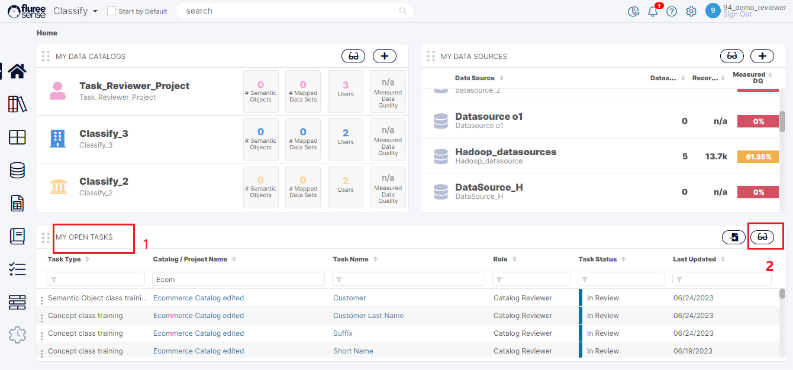
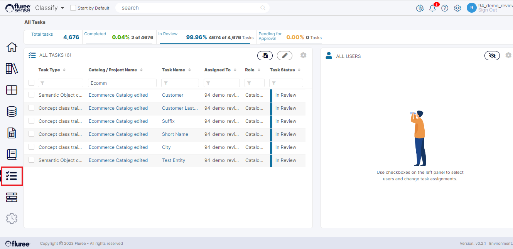

_Catalog Training Tasks_ can be seen either in ‘My Open Tasks’ or ‘All Tasks’ or ‘All My Tasks’ area.  
  
This is different from _Project Tasks_ in _Resolve_ or _Classify_, which are available in these screens as well as their specific Project-related Task Training and Task Managing screens.

Three Common Areas where we can see _Catalog Tasks_ (and other type of Tasks):

| **Screen / Section** | **Tasks it Displays** | **Status of displayed Tasks** |
| --- | --- | --- |
| 1\. My Open Tasks | Any ‘Open’ Task assigned to the logged-on User.  | Displays ‘Open’ Tasks i.e.  tasks which have not been completed yet. |
| 2\. All My Tasks | Any Task assigned to the logged-on User  | It may be a Task, which is now in Completed Status as well. User cannot make changes to a Completed Task but can view its details |
| 3\. All Tasks | Any Task assigned to the Logged-in user AND any Task belonging to the Project or _Catalog_ of which the logged-on user is having an Admin role. | It may be a Task, which is now in Completed Status as well.   |

The images below show how they can be accessed in these 3 common areas either from _Classify_ or _Resolve_, corresponding to their serial number in the table above.  
  
However, _Catalog Tasks_ will only show in _Classify_ as that is a _Classify_ module feature.

## Task Priority

Every Task carries a _Task Priority_ of **High**, **Medium** or **Low**. It gives Reviewers and Approvers a way to tell, at a glance, which of their open Tasks deserve attention first — particularly useful when a production Project generates a long list of Golden Record Change Tasks at once.

The _Task Priority_ appears as a read-only column wherever Tasks are listed:

| Where | Screen |
| --- | --- |
| Home screen | _My Open Tasks_ panel, and the full-screen _View All My Open Tasks_ |
| Common areas | The _Tasks_ screen |
| Inside a production Project | _View Open Golden Record Change Tasks_, _View All Matching Remediation Tasks_ |
| Inside a training Project | _Train Model_ and _Fix Issues_ |

<!-- SCREENSHOT NEEDED: My Open Tasks panel showing the Task Priority column with High / Medium / Low values -->

> **NOTE**: In the _Train Model_ screen, the _Task Priority_ column takes the place of the older _Open_ column with the graduation-hat icon, so the screen doesn't lose horizontal space.

### How priority gets set

Fluree Sense assigns a priority when the Task is created, based on the confidence levels the Project is generating Tasks for:

| Project state | Tasks generated for | Resulting priority |
| --- | --- | --- |
| Production | LOW confidence only | All Tasks set to **High** |
| Production | LOW and MEDIUM confidence | LOW → **High**, MEDIUM → **Medium** |
| Production | All confidence levels | LOW → **High**, MEDIUM → **Medium**, HIGH → **Low** |
| Training | Training Tasks | **Medium** |
| Training | Fixing Tasks | **High** |

The logic is deliberately inverted against confidence: the less certain the model was, the more your judgement is worth, so the Task is pushed up your list.

**System Validations**

1. The _Task Priority_ column is read-only in all the screens listed above. Only the _Project Admin_ can change a Task's priority, and only from the _Manage Project Tasks_ screen inside the Project.

3. _Task Priority_ applies to both _Resolve_ and _Classify_ Tasks.
