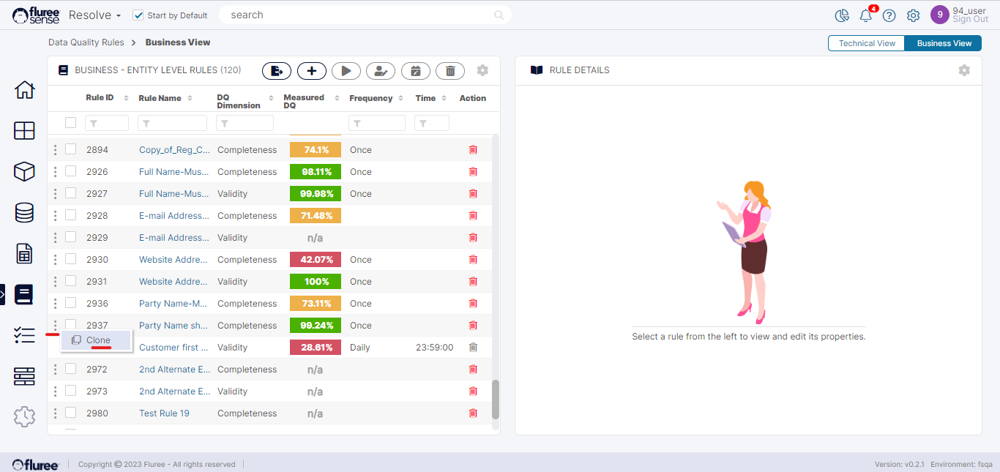

Rules can take a while to build, and often the rule you want is nearly the rule you already have. Cloning saves you that work: you copy an existing rule, adjust what differs, and save.

You can clone a _Business or a Technical rule_ from the main grid by clicking on the ‘Clone’ option in the ellipsis menu next to the Id of the Rule.

Clicking _Clone_ does not create the rule straight away. Instead it opens the rule workflow at the **first screen**, pre-filled with every option chosen for the original rule — much as _Creating a Project_ or _Creating a Catalog_ does. You then step through the workflow with _Next_, changing whatever you need along the way, and the new rule is created when you save.

The new rule is named for you: `Copy_of_` is prefixed to the original rule's name, with the Rule Id suffixed, following the same pattern as cloned Projects.

As you move through the workflow you'll find the original rule's work already in place:

- The _Review Mapping_ screen shows the mappings as they currently apply to the rule.

- The _Select Dataset_ screen shows the Datasets already saved against the original rule — and you can edit them.

- The _Map Data Columns_ screen shows the data columns already dragged and dropped for the original rule — also editable. If a column from the original rule is no longer available, it simply won't appear.

**System Validations**

1. Only a _Rule Admin_ may clone a Rule. Otherwise, the ellipsis menu is disabled.

3. _OOB rules_ cannot be cloned — the ellipsis menu is disabled on them. This prevents the same out-of-the-box rule being applied more than once to the same Concept, which would conflict with the rule that only one OOB rule of a given condition type is allowed per Concept.

5. All the validations that apply to a normal rule being created apply to a cloned rule too.

7. The schedule and entitlements of the original rule are copied to the new Rule as well.

9. If you've started a clone by mistake, you can cancel out of the workflow. As with any rule, a draft created part-way through can be completed later from [Editing of rules](/docs/sense/Classify%20Module/Data%20Quality%20Rules/editing-a-rule-definition/index.md), or removed with the delete option.
