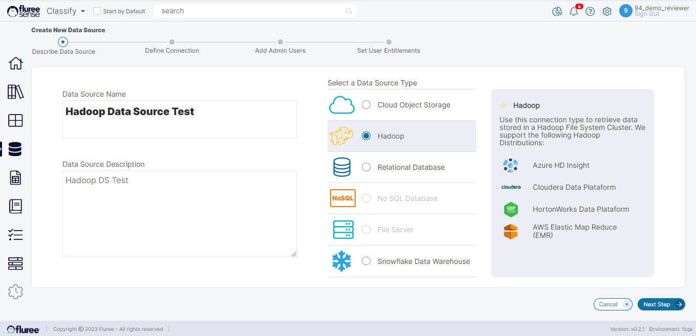
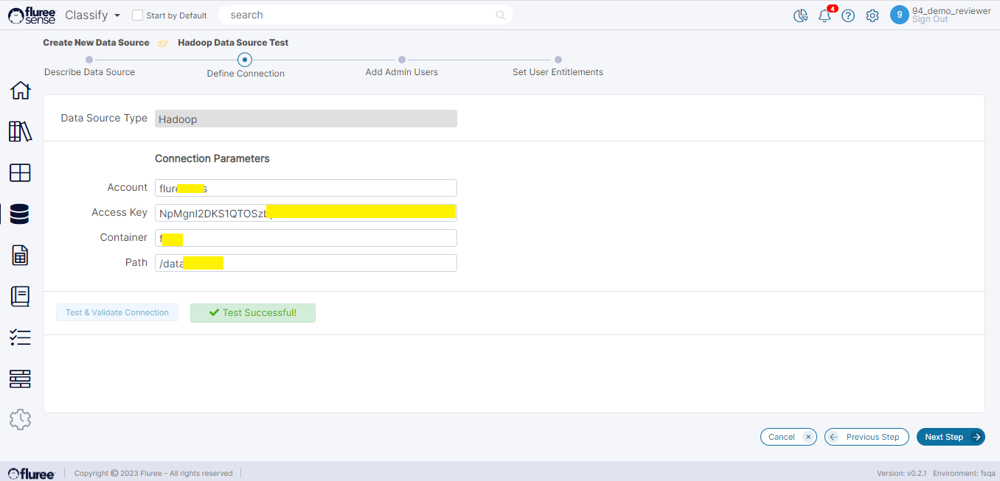

Creating a new Data Source connection begins with choosing the Data Source Type and some other details as shown in the screen below. You can have multiple Data Sources feeding into the _Classify_ product. This also requires entering the:

- Name of the Data Source (Mandatory)

- Description

- Data Source Type and

- Sub Type in some cases

On clicking the Next button, the user can enter the connection details which will depend on the Data Source type chosen in the previous screen. To move ahead, the user needs to add the connection parameters and click on the ‘Test and Validate’ button to make sure that the connection-string is valid.

These details may depend on the Data Source type and subtype but will generally contain the name of the Cloud Account, Access Key, Container and Path.

If valid, the connection string is saved for future use and the Next Step button gets enabled. This can be seen in the screen below:

The Path of the Data Source is the relative path to where your files are placed in case this is a _File Type_ Data Source. These files can be Parquet, CSV etc. The container name is provided for the cloud container name. Our support team can assist you in creating and connecting with data sources for the first time and then the same process can be followed for other Data Sources.

## Connecting to a Relational Database

If you chose _Relational Database_ as the Database Type on the first screen, you'll also have chosen which one — PostgreSQL, Microsoft SQL Server, Oracle or MySQL — from the radio buttons there. The connection screen then asks for a different set of parameters than the cloud flow above.

<!-- SCREENSHOT NEEDED: Define Connection String screen for a relational data source, showing Database System, Connection Method, Server, Database and Schema fields -->

| Field | Notes |
| --- | --- |
| Database System | Defaults to whichever relational database you selected on the first screen, but you can edit it. |
| Connection Method | The available methods depend on the database system — PostgreSQL, Microsoft SQL Server, Oracle and MySQL do not all offer the same options, so this list changes with your selection. |
| Server | The host serving the database. |
| Driver | The driver used to establish the connection. |
| Username / Password | Credentials for the connection. |
| Database | The single database this Data Source connects to. |
| Schema | The schema within that database you want the Data Source associated with. This is mandatory. |

A single Data Source connects to **one** database. If you need data from more than one, create a Data Source for each.

> **NOTE**: The _Test and Validate_ button stays disabled until Database System, Connection Method, Username, Password, Server and Database are all filled in. Once the connection validates, the _Next Step_ button is enabled and the connection string is saved for future use.

The Schema field appears below _Database_ in the _Define Connection String_ panel, and you'll see it in all three places a connection is handled: the Create flow, the Edit flow, and the read-only display of Connection Properties.
