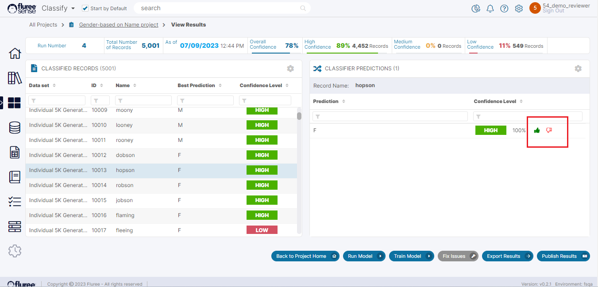

Click on the icon marked \[4\] in the [Project Home Screen](/docs/sense/Classify%20Module/Semantic%20Object%20Classification%20Projects/viewing-project-home-screen/index.md) image to come to the Project Results screen. This screen shows all the results of the project which are really the model’s predicted values for the Classifier.

It’s important to note that any user can provide feedback here, and these aren’t the model generated _Tasks_ but ALL the predicted records. Naturally, it is unlikely that a user will want to provide feedback to all Tasks but the flexibility and capability is there to filter specific input(s) and provide the feedback for such predictions, which may or may not be present in the generated Tasks.

## Seeing Feedback Others Have Already Given

Because any project user can give feedback here, it's easy to overwrite a colleague's judgement without ever knowing they'd made one. To prevent that, the right-hand panel shows a **count** next to each prediction's upvote and downvote — the same counters you'll be familiar with from Concept mappings.

<!-- SCREENSHOT NEEDED: View Results right panel showing upvote/downvote counters against a predicted class -->

The counts pull together feedback from everywhere it can be given: Training Tasks, Fixing Tasks, and this screen. Click a count to open a pop-up listing who gave that feedback and when, so you can weigh a prior decision before changing it.

As elsewhere in Fluree Sense, the thumb icon is shown filled if _you_ are the one who cast that vote.

**System Validations**

1. If another user has already given feedback on a prediction, your feedback increments the relevant counter alongside theirs.

3. If you give feedback a second time on the same prediction, your newer feedback replaces your older one and the counter does not increase.
