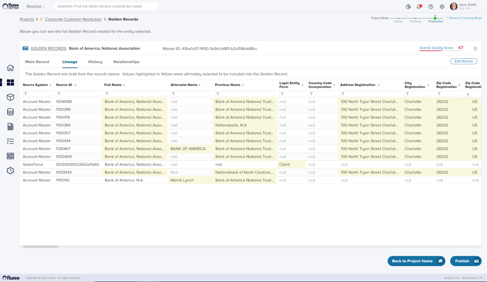

Once your Project is producing Golden Records, two tabs help you understand and correct how those records were assembled: the _Lineage_ tab, which shows where each value came from, and the _Relationships_ tab, which shows how a Golden Record relates to other entities in your data.

## The Lineage Tab

Another important view of Golden Records that users may want to see is the Golden Records _Lineage view_. As the name suggests, this view shows which specific records across the source systems have been combined to create the Golden Records after the resolving and mastering operations.

After opening a specific Golden Record, you can click on the _Lineage_ tab to get this view.

In the image above, the values in highlighted background color indicate that they’ve been selected for the Golden Record.

If a user edits a Golden record providing value for an attribute from his / her own side - rather than choosing from the list, the lineage for that Golden Record will display a new row with that specific column highlighted and the source showing as the user.

**Note:** Above example is only for illustration purposes and the data is neither actual nor implies an actual client relationship.

## Splitting Records out of a Golden Record

Sometimes the resolving process pulls a record into a cluster where it doesn't belong. Rather than living with the wrong Golden Record, you can split the offending records out directly from the _Lineage_ tab — either into a cluster of their own, or into a different existing cluster where they actually belong.

Each record in the Lineage list carries a checkbox. Select one or more records and the _Split Records_ button becomes active.

<!-- SCREENSHOT NEEDED: Lineage tab with record checkboxes selected and the 'Split Records' button enabled -->

Clicking it opens the **Split Cluster** pop-up, which is where you decide where the records should go. It has four sections:

| Section | Purpose |
| --- | --- |
| SELECTED CLUSTER | The cluster you're splitting records out of. |
| Search for Entity Clusters | Search for an existing cluster to move the records into. |
| SEARCH RESULTS | The clusters your search returned, ready to select. |
| None of the above - Create it's own cluster | The `+` option, for when the records belong to neither — they become a brand new cluster. |

So you have two outcomes available. Search for and select an existing cluster to move the records there, or tick the record and use the `+` on _None of the above_ to spin up a new cluster (which appears in the pop-up straight away as _New Cluster 1_).

Once a destination is set, the _Split Cluster_ button becomes enabled. Press it and Fluree Sense raises a notification confirming the job has been triggered; click _Continue_ to return to the Lineage screen. If you change your mind before that, _Cancel_ closes the pop-up and leaves every record where it was.

When the split completes:

- The selected record(s) are removed from the original cluster and no longer appear in its Lineage screen.

- The records land in their destination — a new cluster, or the existing cluster you chose.

- Matching rules are re-evaluated for both impacted clusters.

- The Golden Record is recalculated for both clusters — the original is updated to exclude the split values, and the new cluster's Golden Record is created and displayed.

> **NOTE**: A newly created cluster initially shows a record count of **0** in _View Results_ under _Entities Resolved_. Click into it and you'll find the split record listed on the right as an orphan record, waiting for the delta job to finish folding it in.

**System Validations**

1. The _Split records_ button stays disabled when no checkbox is selected, and also when _every_ checkbox is selected — splitting an entire cluster out of itself would leave nothing behind.

3. Who may split depends on your Four-eyes check setting, because splitting edits Golden Records. With the Four-eyes check **OFF**, the _Project Admin_ and _Reviewer_ can split. With the Four-eyes check **ON**, the _Project Admin_, _Reviewer_ and _Approver_ can split.

5. If the algo job fails, it is re-run and the failure is surfaced in the UI rather than failing silently.

## The Relationships Tab

The _Relationships_ tab shows you how the Golden Record you're viewing sits alongside other entities. It groups them into three sections:

- **Potential Duplicates** — entities that look like they may belong to this Golden Record but were not merged into it.

- **Parent Entities** — entities that sit above this one in the relationship hierarchy.

- **Child Entities** — entities that sit below this one in the relationship hierarchy.

<!-- SCREENSHOT NEEDED: Relationships tab showing Potential Duplicates, PARENT ENTITIES and CHILD ENTITIES sections -->

Entities listed as Potential Duplicates are not stuck there. If one plainly belongs to this Golden Record, the _Merge Entities_ button pulls it in — see [Merging Potential Duplicate Entities](/docs/sense/Resolve%20Module/Golden%20Records/Merging%20Potential%20Duplicate%20Entities/index.md) for that flow.
